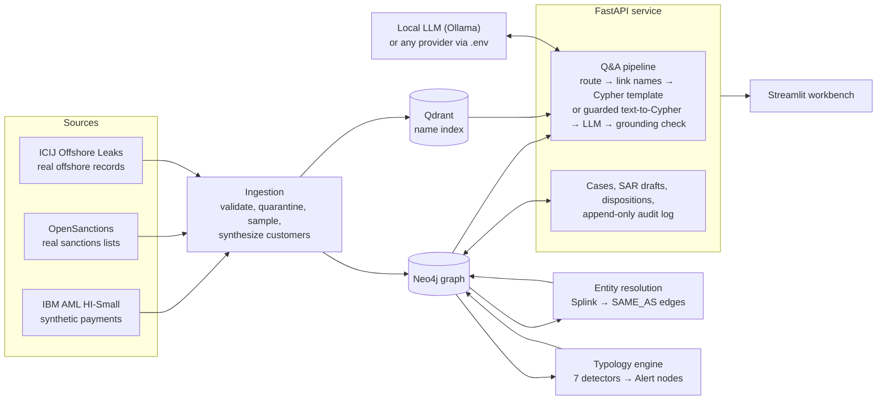

# AML Investigation Copilot

[](https://github.com/sanskrutimahajan/AML-Investigation-Copilot/actions/workflows/ci.yml)

A Graph-RAG investigation assistant and workbench for anti-money-laundering (AML) analysts. It takes
an alert from triage to a reviewed SAR draft and a recorded decision. Every answer and draft cites the
graph IDs it rests on, and an unsupported answer is withheld. **The copilot recommends; the analyst
decides.** It never closes a case or files a report on its own.

Everything runs locally: `docker compose up`, plus a local LLM through Ollama. No API key is needed
and nothing is billed.

> Portfolio prototype, not a production AML system. Transactions and customers are synthetic; the
> links between customers and real sanctions or ICIJ records are planted for evaluation and are not
> evidence about any real person or company. ICIJ inclusion does not imply wrongdoing.

## The problem

Transaction monitoring raises alerts on rules and patterns, and many of them turn out not to be
suspicious. Each alert still needs an analyst to work out who the customer is, where the money came
from and went, and whether the name matches a sanctioned or offshore party. That evidence usually
sits in separate systems, so the investigation is slow and hard to audit.

This project puts the payments, customers and reference records in one graph, so those questions
become graph queries. It then wraps them in a workflow that records every analyst action.

## Who uses it, and the workflow

The users are financial-crime analysts and investigators, typically on a bank's financial
intelligence unit (FIU) team.

| Step | What the analyst does | Where |
| --- | --- | --- |
| 1. Alert triage | Review what monitoring flagged; replay the queue as of any day | **Overview**, **Alert queue** |
| 2. KYC/CDD review | See who owns the accounts and their links to sanctions or offshore records | **Subject profile** |
| 3. Screening | Fuzzy name search over OpenSanctions, ICIJ and customers | **Name screening** |
| 4. Network investigation | The alert's subgraph, facts re-checked in the graph, and cited questions | **Cases**, **Investigation assistant** |
| 5. SAR draft | Generate a grounded draft, edit it, save it as reviewed | **Cases** |
| 6. Disposition | Close, escalate or file SAR, with a required rationale; the audit trail records it | **Cases** |

Before, an analyst assembles evidence by hand from several systems. After, a case opens with the
alert's subgraph, re-checked facts and a cited draft, ready for review.

## Demo

**Demo GIF: not recorded yet.** It will go at `docs/demo.gif`.

There is no hosted instance; it runs locally. For a lighter **demo mode**, set a small local model
(`LLM_MODEL=qwen2.5:3b-instruct`) or a free-tier OpenAI-compatible provider in `.env`; no code
changes are needed ([docs/SETUP.md](docs/SETUP.md#using-a-different-llm)). Reported results come
from `qwen2.5:7b-instruct`.

## Architecture



The Q&A step is a fixed pipeline, not an agent: each step is testable, and the LLM only routes,
writes sentences and drafts. LangGraph was considered and not used
([AUDIT.md](AUDIT.md#approved-decisions-2026-11-18)).

## Quick start

Needs Docker Desktop, [Ollama](https://ollama.com), and Python 3.11 with
[`uv`](https://docs.astral.sh/uv/) for loading data and running tests.

```sh
cp .env.example .env               # set NEO4J_PASSWORD
ollama pull qwen2.5:7b-instruct    # Ollama runs on the host, for GPU access
docker compose up -d --wait        # Neo4j, Qdrant, API (:8000) and workbench (:8501)
uv sync && make seed               # once, after downloading the data: graph, ER edges, index, alerts
```

Open http://127.0.0.1:8501, enter an analyst name in the sidebar, and open a case from the alert
queue. Data download, the full pipeline and the development setup are in
[docs/SETUP.md](docs/SETUP.md).

## Design decisions and trade-offs

Each decision is recorded as an ADR in [docs/decisions/](docs/decisions/).

### Why Graph-RAG instead of ordinary RAG?

Laundering is a pattern in relationships: money moved along a chain of accounts, money that comes
back to where it started, many senders paying one account, a customer whose name matches a
sanctioned director. Those are paths and neighbourhoods, which a graph stores and queries directly.

- **Ordinary RAG** retrieves text passages by embedding similarity, but this data has no passages:
  it is accounts, amounts, timestamps and names. "Is A connected to B?" needs a traversal, so the
  graph is the retriever.
- **Qdrant** does the one job embeddings do well here: finding the record a typed name refers to,
  despite typos and transliteration ([ADR 009](docs/decisions/009-retrieval-and-qa.md)).
- **SQL** would turn multi-hop questions into recursive self-joins; in Cypher a 4-hop path is one
  line.

### Local LLM instead of a hosted API

The default model runs locally, so customer data never leaves the machine and nothing is billed.
The cost is speed and quality: drafts take about a minute, and the 7B model misreads numbers that
are present in the evidence. Any OpenAI-compatible endpoint or Anthropic works through `.env` alone
([ADR 008](docs/decisions/008-llm-provider.md)).

### Rules plus LLM, each where it is strong

| Job | Done by | Why |
| --- | --- | --- |
| Finding patterns | Rule-based detectors | Explainable to an analyst and a regulator; each alert states what it counted ([ADR 010](docs/decisions/010-typology-detection.md), [ADR 015](docs/decisions/015-more-typologies.md)) |
| Matching names | Splink (probabilistic record linkage) | Explainable per field. The local LLM's review of borderline pairs *lowered* F1, so it changes no edge ([ADR 007](docs/decisions/007-entity-resolution.md)) |
| Totals, paths, facts | Cypher queries | The LLM never computes a fact |
| Routing, wording, drafts | LLM | Language work only, checked by the grounding check |
| Decisions | The analyst | Disposition needs a rationale; filing needs a reviewed draft ([ADR 012](docs/decisions/012-cases-and-disposition.md)) |

### Guardrails

| Risk | Guard |
| --- | --- |
| The LLM invents a fact or number | Cited IDs and numbers must be in the evidence; one regeneration, then "insufficient evidence" |
| LLM-written Cypher changes or floods the database | Read-only session; `EXPLAIN` schema check; row limit, hop limit and timeout; case and audit data cannot be named |
| Text in a record acts as an instruction | Prompts treat evidence as data, not instructions |
| Personal data in logs | JSON logs record route templates and request IDs, never names or IDs ([ADR 013](docs/decisions/013-structured-logging.md)) |
| Evaluations that flatter the model | Tuning on development splits; each held-out split scored once; baselines and confidence intervals |

## Evaluation results

Every figure comes from an evaluation command in this repo, with the result file committed in
`eval/results/` and the LLM provider and model recorded in it. `make eval` collects every cited file
into one report without re-running anything. Details, intervals and failures:
[docs/RESULTS.md](docs/RESULTS.md).

| Capability | Held-out result | Comparison |
| --- | --- | --- |
| Entity resolution (customer ↔ sanctions/offshore record) | F1 0.642 (95% CI 0.611–0.672) | Exact-name baseline 0.411 |
| Cited question answering (60 questions, gold answers) | 47/60 correct (0.78) | List questions 0/10 (disclosed failure) |
| Citation coverage of those answers | 110/110 claims cite graph IDs | Coverage, not correctness |
| Typology detection, original four | Pattern recall 0.41–0.96 by typology | Fan-out does not clearly beat a degree baseline |
| Layering and mule hubs | Recall 29/35 and 34/34; precision 0.80 and 0.70 | Degree baseline: precision 0.60 and 0.51 |
| Rapid movement | Precision 0.61 | Worse than the baseline (0.86); writes no alerts |
| Structuring | 40/40 injected cases, 0/120 decoys | Our own injected cases: tests the logic only |
| SAR drafts (20 alerts) | 16/20 grounded, 4 abstained; 67/67 claims cited | Every draft labeled `DRAFT – requires analyst review` |
| Synthetic-data leakage check | Max ROC-AUC 0.621 (target ≤ 0.60) | Reported as FAIL; disclosed judgment call |

Latency with `qwen2.5:7b-instruct` on an Apple M2 with 24 GB: questions p50 9.6 s, p95 27.5 s; SAR
drafts p50 63.5 s, p95 209 s.

**Found and fixed along the way** (full table in [docs/RESULTS.md](docs/RESULTS.md#failures-found-and-fixed)):
- Leaky synthetic data, mislabeled exact-name customers, and staging that changed with the run date.
- The local LLM made entity resolution worse, so it no longer changes edges.
- A SAR draft called the largest payment "the total"; this is why filing requires analyst review
  and every alert shows facts recomputed from the graph.

## Data provenance

| Data | Real or synthetic | Source and license |
| --- | --- | --- |
| Payments and laundering labels | Synthetic (IBM AML HI-Small, 270,523 of 5,078,345 payments, all 5,177 laundering ones kept) | [Kaggle](https://www.kaggle.com/datasets/ealtman2019/ibm-transactions-for-anti-money-laundering-aml), CDLA-Sharing 1.0 |
| Sanctioned people and companies | Real (OFAC SDN, EU, UN; 20,395 entities) | [OpenSanctions](https://www.opensanctions.org/datasets/), CC BY-NC 4.0 |
| Offshore entities and officers | Real (22,000 of 2,016,523 nodes) | [ICIJ Offshore Leaks](https://offshoreleaks.icij.org/pages/database), ODbL / CC BY-SA |
| Customers | Synthetic (37,515), 1,125 with names derived from real records, plus 375 homonyms and 375 look-alikes | Generated here; `synthetic: true` |
| Customer ↔ record links | Synthetic; every edge carries `synthetic_link: true` | Entity resolution |

Provenance is shown wherever data appears: fixed notices in API responses and the workbench, labels
on every synthetic record and link, and the DRAFT label on every SAR. The sample keeps every
laundering payment, so laundering is about 19× more common than in the full data, and detection
precision here is not real-world precision ([ADR 005](docs/decisions/005-sampling-bias-and-detection-evaluation.md)).
Data is downloaded by hand and never committed ([licenses](docs/DATA_LICENSES.md)).

## Limitations

- **Synthetic data:** the scores measure the method against planted links and simulated patterns,
  not real-world performance. Evaluation sets are small (10 questions per QA family, 17–35 patterns
  per typology), so the intervals are wide.
- **Known failures:** list questions are routed to the wrong template (0/10); homonyms get a false
  `SAME_AS` 79% of the time; fan-out overfits its development split; rapid movement does not beat
  the baseline.
- **The grounding check cannot catch a misread number** that is present in the evidence.
- **No authentication:** the analyst name is self-declared, and the audit log is append-only by
  code, not by database permission.
- **Alert volume:** 5,416 alerts on 270,523 payments, most from mule-hub and layering detection.
- **Speed:** a local 7B model takes about a minute per SAR draft.

## What it would take to go to production

- **BSA/AML and KYC/CDD requirements:** real customer due-diligence data (identity verification,
  beneficial ownership, risk ratings) in place of synthetic customers. The alert, case and
  disposition flow would also need to map to the institution's written AML program. Screening data
  would need a commercial license: OpenSanctions is CC BY-NC 4.0, and its terms say compliance use
  inside a business needs one.
- **SAR filing workflow:** today "file SAR" records a decision. Production needs regulator-format
  output (such as FinCEN's BSA E-Filing in the US), filing deadlines, a second-level approval, and
  continuing-activity reviews.
- **Model risk management and validation:** independent validation of every detector and of the
  matching model (conceptual soundness, outcome analysis, benchmarking), as supervisors expect for
  models under guidance such as SR 11-7. Thresholds, model and prompt versions, and changes would
  need to be documented and approved.
- **Access control and audit logging:** single sign-on and role-based access (analyst, reviewer,
  approver), and audit events written to tamper-evident storage with retention rules. Analyst
  identity would come from login rather than a typed name.
- **Data residency and privacy:** customer data kept in approved regions and systems. A hosted LLM
  only under a data-processing agreement, or a self-hosted model. PII controls extended from logs to
  backups and exports.
- **Integration:** feeds from core banking and payment systems, alerts from the existing monitoring
  system, and cases synchronized with the case-management platform, instead of batch files.
- **Tuning to reduce false positives:** thresholds tuned on the institution's own dispositions
  (below-the-line testing, segmentation by customer type). Analyst outcomes would feed back as
  labels.
- **Retraining and drift monitoring:** monitoring of alert rates, disposition outcomes, match-score
  distributions and LLM grounding failures over time, with scheduled re-validation and retraining
  when they shift.

## Repository

The code lives in one Python package, `tracegraph` (under `src/`); the project itself is AML
Investigation Copilot.

```text
src/tracegraph/  ingest/ graph/ er/ retrieval/ generation/ detection/ cases/ llm/ api/
ui/              Streamlit workbench
eval/            evaluation commands; cited results in eval/results/
docs/            RESULTS.md, SETUP.md, PROPOSAL.md, DATA_LICENSES.md, decisions/ (ADRs), worklog.md
tests/           unit tests, plus integration tests against throwaway Neo4j/Qdrant containers
```

**Stack:** Python 3.11, `uv`, Polars, Neo4j 5, Qdrant, `sentence-transformers`
(`BAAI/bge-small-en-v1.5`), Splink, FastAPI, Streamlit, Ollama, Docker Compose, pytest, Ruff, mypy,
GitHub Actions.
