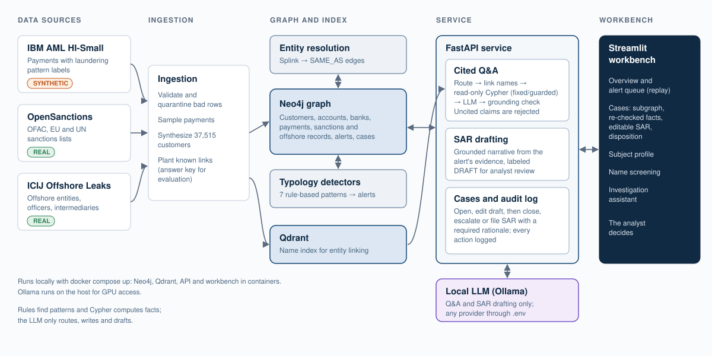

# AML Investigation Copilot

[](https://github.com/sanskrutimahajan/AML-Investigation-Copilot/actions/workflows/ci.yml)

A Graph-RAG assistant and workbench that takes anti-money-laundering (AML) analysts from an alert
to a reviewed suspicious activity report (SAR) draft and a recorded decision.

> Portfolio prototype. Transactions and customers are synthetic; links to real sanctions or ICIJ
> records are planted for evaluation and are not evidence about any real person or company.

## Overview

- **Problem:** monitoring raises many alerts that turn out to be harmless, and each one needs
  evidence pulled together by hand from separate systems.
- **Users:** financial-crime analysts on a bank's investigations team.
- **Workflow, as in a bank:** prioritized alert queue → customer case → investigate → SAR draft
  → recommendation → second-person approval.
- **Grounded answers:** every answer cites graph IDs, and unsupported answers are withheld.
- **The analyst decides:** the copilot never closes a case or files a report itself.
- **Runs locally:** `docker compose up` plus a local LLM; no API key, nothing billed.

## How it works



- **Retrieval:** each question runs a fixed Cypher query, or LLM-written Cypher that must pass
  read-only and schema checks.
- **Generation:** the LLM writes cited sentences from the returned rows; a grounding check rejects
  any ID or number that is not in the evidence.
- **Detection:** seven rule-based detectors (fan-in, fan-out, cycle, scatter-gather, layering, mule
  hub, structuring) raise alerts.
- **Matching:** Splink matches customers to sanctions and offshore records.
- **Casework:** customer cases with owners, deadlines, roles and four-eyes approval; every action
  goes to an append-only audit log.

## Monitoring scenarios

Each scenario is a rule over the payment graph; an alert says what it counted.

| ID | Scenario | What it looks like | Why it matters |
| --- | --- | --- | --- |
| TM-01 | Funnel account activity (fan-in) | Many accounts pay one account in a short time | Pooling money, e.g. from mules |
| TM-02 | Rapid dispersal of funds (fan-out) | One account pays many accounts in a short time | Splitting money so it is harder to follow |
| TM-03 | Round-trip transfers (cycle) | Money leaves an account and comes back through others | Makes illicit money look like income |
| TM-04 | Split-and-recombine (scatter-gather) | One account → several middle accounts → one final account | Hides a transfer between two parties |
| TM-05 | Layering through pass-through accounts | Money passed along a chain, each account paying it on quickly | Each hop distances money from its source |
| TM-06 | Money mule account | An account collects from several senders, then pays out | A pass-through account in a mule network |
| TM-07 | Cash structuring | Several cash deposits just under the 10,000 USD reporting limit | Avoids the bank's mandatory report |

## How a case is worked

- **Priority:** every alert gets a 0–100 score, banded High, Medium or Low. The score adds the
  scenario's weight, the alert's strength, any watchlist match on the customer, and the customer's
  other alerts. The queue is worked highest first.
- **One case per customer:** opening a case gathers all of that customer's alerts. Each case has an
  owner, a review due date and a 30-day SAR filing deadline.
- **Roles:**
  - an analyst (L1) investigates and escalates or recommends;
  - an investigator (L2) takes escalated cases;
  - an approver signs off.
- **Four eyes:** a recommendation to close or file waits for an approver who did not make it.
  Filing needs a reviewed draft, and the draft is frozen while approval is pending.
- **Audit trail:** every action records who, which role, when and why.

## Why Graph-RAG instead of ordinary RAG?

- Laundering shows up in relationships: payment chains, money returning to its source, many senders
  paying one account.
- Those are graph traversals, not text searches.
- The data has no text passages, so the graph is the retriever; Qdrant only matches names to
  records.
- The LLM never computes facts: totals and paths come from Cypher.

## Results

All figures come from held-out runs, scored once after tuning on a development split. Details:
[docs/RESULTS.md](docs/RESULTS.md).

| Capability | Result | Compared with |
| --- | --- | --- |
| Entity resolution | F1 0.642 (95% CI 0.611–0.672) | Exact-name matching: 0.411 |
| Cited Q&A (60 questions) | 47/60 correct; 110/110 claims cited | List questions: 0/10 |
| Layering / mule-hub detection | Recall 29/35 and 34/34; precision 0.80 and 0.70 | Degree baseline: 0.60 and 0.51 |
| Original four detectors | Pattern recall 0.41–0.96 | Fan-out ≈ baseline |
| SAR drafts (35 alerts) | 30/35 grounded, 5 abstained; 134/134 claims cited | All labeled DRAFT |
| Leakage check | Max ROC-AUC 0.621 | Target ≤ 0.60 (FAIL, disclosed) |

- **Speed:** questions 9.6 s and SAR drafts 61 s at the median, on an Apple M2 with
  `qwen2.5:7b-instruct`.
- **Limits:**
  - synthetic data and small test sets;
  - homonyms are the main matching error;
  - a misread number can still pass the grounding check;
  - the rapid-movement detector is unused (it lost to the baseline);
  - priority weights are judgment, not validated;
  - there is no login, so names and roles are self-declared.

## Data

| Data | Type | Source |
| --- | --- | --- |
| 270,523 payments (all 5,177 laundering kept) | Synthetic | [IBM AML HI-Small](https://www.kaggle.com/datasets/ealtman2019/ibm-transactions-for-anti-money-laundering-aml) |
| 20,395 sanctioned people and companies | Real | [OpenSanctions](https://www.opensanctions.org/datasets/) |
| 22,000 offshore entities and officers | Real | [ICIJ Offshore Leaks](https://offshoreleaks.icij.org/pages/database) |
| 37,515 customers and their links | Synthetic | Generated here |

## Quick start

```sh
cp .env.example .env               # set NEO4J_PASSWORD
ollama pull qwen2.5:7b-instruct
docker compose up -d --wait        # Neo4j, Qdrant, API :8000, workbench :8501
uv sync && make seed               # once, after downloading the data
```

Open http://127.0.0.1:8501. Full setup: [docs/SETUP.md](docs/SETUP.md).

## Going to production would need

- Real KYC/CDD data, and a commercial OpenSanctions license.
- Regulator-format SAR filing with second-level approval.
- Independent model validation (SR 11-7).
- SSO, role-based access and a tamper-evident audit store.
- Data residency controls.
- Integration with core banking and case management.
- Tuning on real dispositions, and drift monitoring.

## Repository

- `src/tracegraph/`: code
- `ui/`: workbench
- `eval/`: evaluations
- `tests/`: unit and integration tests
- `docs/`: results, setup and decision records
