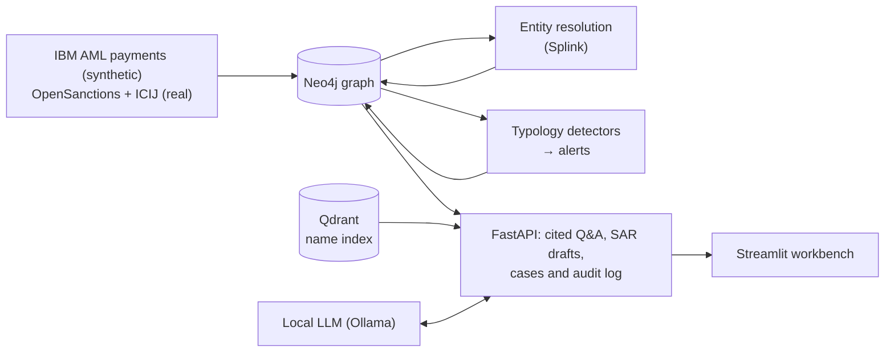

# AML Investigation Copilot

[](https://github.com/sanskrutimahajan/AML-Investigation-Copilot/actions/workflows/ci.yml)

A Graph-RAG investigation assistant and workbench for anti-money-laundering (AML) analysts. It
takes an alert from triage to a reviewed suspicious activity report (SAR) draft and a recorded
decision. Every answer cites the graph IDs it rests on, and unsupported answers are withheld. **The
copilot recommends; the analyst decides.** It runs locally with `docker compose up` and a local LLM,
with no API key and nothing billed.

> Portfolio prototype. Transactions and customers are synthetic; links to real sanctions or ICIJ
> records are planted for evaluation and are not evidence about any real person or company.

## Overview

**Problem.** Transaction monitoring raises many alerts that turn out not to be suspicious, and each
one needs an analyst to piece together evidence from separate systems: who the customer is, where
the money went, and whether the name matches a sanctioned party.

**Users and workflow.** Financial-crime analysts on a bank's investigations team:

1. Triage alerts from seven laundering-pattern detectors.
2. Review the customer and their links to sanctions and offshore records.
3. Investigate the alert's subgraph and ask cited questions in plain English.
4. Generate a grounded SAR draft, edit it, and save it as reviewed.
5. Close, escalate or file the SAR, with a required rationale. Every action goes to an audit log.

**How it works.**



A question is routed to a fixed Cypher query, or to LLM-written Cypher that must pass read-only and
schema checks. The LLM writes sentences from the returned rows, and a grounding check rejects any
cited ID or number that is not in the evidence.

**Why Graph-RAG instead of ordinary RAG?** Laundering shows up in relationships: chains of
payments, money returning to its source, many senders paying one account, a customer matching a
sanctioned director. Those are graph traversals. The data has no text passages for ordinary RAG to
retrieve, so the graph is the retriever, and Qdrant only matches typed names to records.

**Key choices** (details in [docs/decisions/](docs/decisions/)):
- **Rules find patterns, the LLM only writes:** detectors and Splink are explainable, and totals and
  paths come from Cypher, never the LLM.
- **Local LLM by default:** private and free; any provider works through `.env`.
- **The analyst decides:** filing needs a reviewed draft.

## Results

Each figure is from a held-out run, scored once after tuning on a separate development split, with
the result file committed in `eval/results/`. Details, intervals and failures are in
[docs/RESULTS.md](docs/RESULTS.md).

| Capability | Result | Compared with |
| --- | --- | --- |
| Entity resolution (customer ↔ sanctions/offshore record) | F1 0.642 (95% CI 0.611–0.672) | Exact-name matching: 0.411 |
| Cited question answering (60 questions) | 47/60 correct; 110/110 claims cite IDs | List questions fail: 0/10 |
| Layering and mule-hub detection | Recall 29/35 and 34/34; precision 0.80 and 0.70 | Degree baseline: 0.60 and 0.51 |
| Original four detectors | Pattern recall 0.41–0.96 | Fan-out does not clearly beat the baseline |
| SAR drafts (20 alerts) | 16/20 grounded, 4 abstained; all labeled DRAFT | — |
| Synthetic-data leakage check | Max ROC-AUC 0.621 | Target ≤ 0.60: reported as FAIL |

On an Apple M2 (24 GB) with `qwen2.5:7b-instruct`, questions take 9.6 s at the median and SAR
drafts 63.5 s.

**Limitations.**
- The data is synthetic and the evaluation sets are small.
- Homonyms are the main matching error: 79% get a false match, and they make up half of all false
  positives.
- The grounding check cannot catch a number that is present but misread.
- The rapid-movement detector did not beat its baseline, so it is not used.
- There is no login.

## Data

| Data | Real or synthetic | Source |
| --- | --- | --- |
| 270,523 payments, all 5,177 laundering ones kept | Synthetic | [IBM AML HI-Small](https://www.kaggle.com/datasets/ealtman2019/ibm-transactions-for-anti-money-laundering-aml) (CDLA-Sharing 1.0) |
| 20,395 sanctioned people and companies | Real | [OpenSanctions](https://www.opensanctions.org/datasets/) (CC BY-NC 4.0) |
| 22,000 offshore entities and officers | Real | [ICIJ Offshore Leaks](https://offshoreleaks.icij.org/pages/database) (ODbL) |
| 37,515 customers and their links to records | Synthetic, labeled as such | Generated here |

## Quick start

```sh
cp .env.example .env               # set NEO4J_PASSWORD
ollama pull qwen2.5:7b-instruct
docker compose up -d --wait        # Neo4j, Qdrant, API (:8000), workbench (:8501)
uv sync && make seed               # once, after downloading the data
```

Open http://127.0.0.1:8501 and enter an analyst name in the sidebar. Setup, data download and the
full pipeline are in [docs/SETUP.md](docs/SETUP.md). The demo GIF is not recorded yet.

## Going to production

The main work would be:
- real KYC/CDD data;
- regulator-format SAR filing with second-level approval;
- independent model validation (as under SR 11-7);
- single sign-on with role-based access and a tamper-evident audit store;
- data residency controls;
- integration with core banking and case-management systems;
- false-positive tuning on the institution's own dispositions;
- drift monitoring;
- a commercial OpenSanctions license.

## Repository

`src/tracegraph/` (the code package), `ui/`, `eval/`, `tests/`, and
[`docs/`](docs/) for results, setup, ADRs and the worklog. Stack: Python 3.11, Neo4j 5, Qdrant,
Splink, FastAPI, Streamlit, Ollama, Docker Compose, GitHub Actions.
